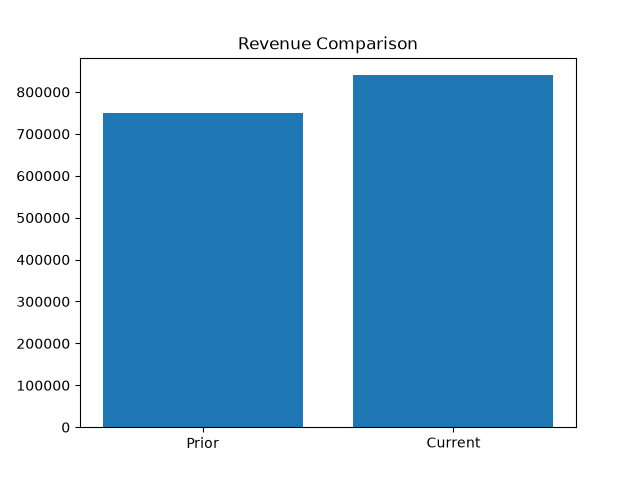

# Business KPI Analysis
## Client Presentation

### Slide 1: Context

**Purpose:** Review business performance using key performance indicators (KPIs).

**Data:** Business data used in the Business KPI Analysis project.

**Scope of analysis:**
- Revenue
- Growth Rate
- Churn Rate
- Average Order Value

**Comparison:** Current values against prior values.

---

### Slide 2: Data

**Data used:** Business data from the Business KPI Analysis project.

**KPIs analysed:**
- Revenue
- Growth Rate
- Churn Rate
- Average Order Value

**Comparison:** Current values compared with prior values.

**Data limitations and caveats:**
- The report does not specify the exact reporting period.
- The report does not document missing values or other data-quality checks.
- The findings should be interpreted within the scope of the available data.

---

### Slide 3: Finding 1 — Revenue Growth

**Headline:** Revenue increased by 12%.

**Current revenue:** 840,000

**Prior revenue:** 750,000

**Change:** +90,000 (12%)

**Why it matters:** The business generated more revenue than in the prior period, indicating improved revenue performance.

**Visual:** Use a bar chart comparing prior revenue (750,000) and current revenue (840,000).

---

### Slide 4: Findings 2 and 3

**Finding 2: Churn Rate**

- Current churn rate: 6.42%
- Prior churn rate: 4.31%
- Reported percentage change: 6.99%

**Why it matters:** The churn rate increased, which may indicate that more customers are leaving the business. This deserves investigation.

**Finding 3: Average Order Value**

- Current average order value: 2,400
- Prior average order value: 2,343.75
- Increase: 2.4%

**Why it matters:** Customers are spending slightly more per order.

**Additional KPI:** The report shows a growth rate of 12%, compared with 7.14% previously.

---
### 5: Recomedations

**Recommendation 1: Improve customer retention**
- Investigate why the churn rate increased.
- Develop actions to retain existing customers.
- **Owner:** Customer Relations Team
- **Timeline:** Within 30 days

**Recommendation 2: Maintain revenue growth**
- Identify the activities contributing to revenue growth.
- Continue supporting successful sales activities.
- **Owner:** Sales Team
- **Timeline:** Within 30 days

**Recommendation 3: Increase average order value**
- Explore ways to encourage customers to purchase more per order.
- Monitor average order value monthly.
- **Owner:** Sales and Marketing Team
- **Timeline:** Within 60 days