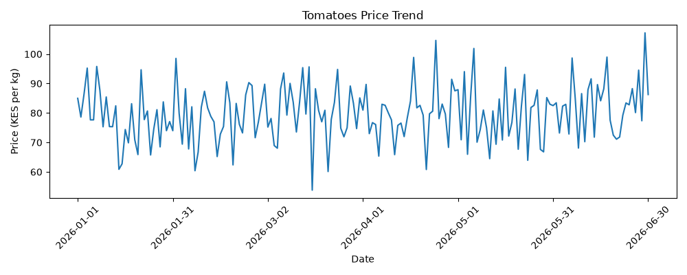
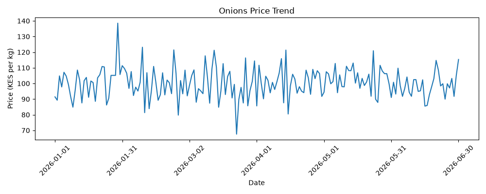
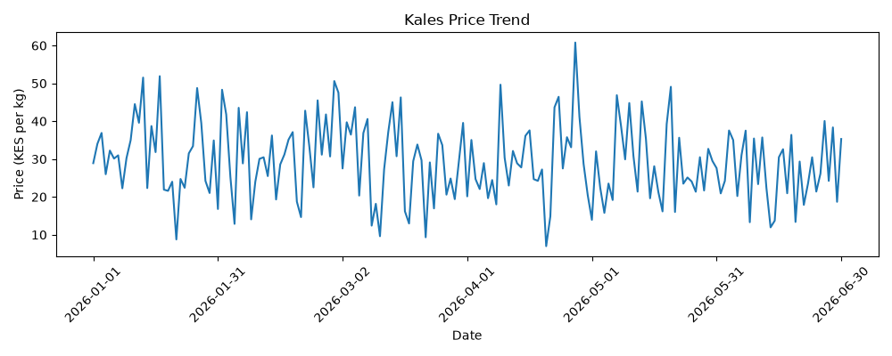
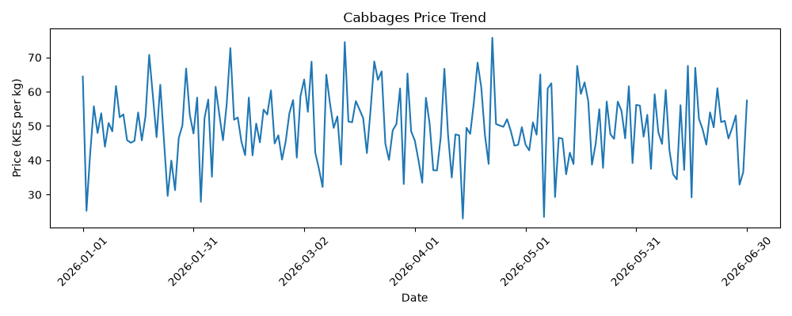
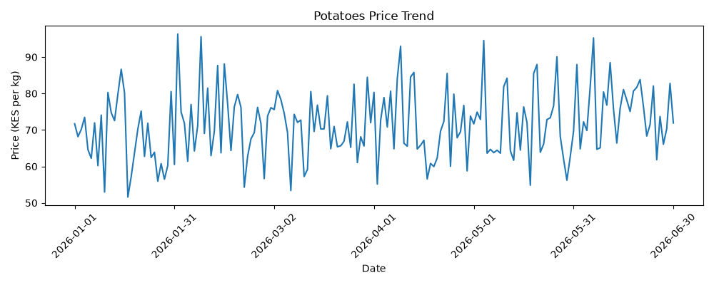

# Nairobi Produce Market Analysis

## Overview
An analyzed vegetable price trends in Nairobi using Python, Pandas, and Matplotlib.

The analysis covers five vegetables:
- Tomatoes
- Onions
- Kales
- Cabbages
- Potatoes

## Analysis Performed
- Generated and analyzed vegetable price records.
- Calculated average prices for each vegetable.
- Measured price volatility using standard deviation.
- Identified the highest cabbage price and its date.
- Created separate price trend charts for each vegetable.

## Key Findings
- Onions had the highest average price at approximately KES 100.33 per kg.
- Kales had the lowest average price at approximately KES 29.42 per kg.
- Cabbages had the highest price volatility.
- The highest cabbage price was KES 75.73 per kg on 22 April 2026.

## Structure
- `produce_analysis.py` — Python analysis script.
- `data/produce_prices.csv` — Vegetable price dataset.
- `charts/` — Five individual vegetable price trend charts.

## Requirements
- Python
- Pandas
- NumPy
- Matplotlib

## How to Run
1. Install the required libraries:
   `python -m pip install pandas numpy matplotlib`
2. Open the project folder in VS Code.
3. Run:
   `python produce_analysis.py`

## Charts

The following charts show the price trends for each vegetable.

### 1. Tomatoes

### 2. Onions

### 3. Kales

### 4. Cabbages

### 5. Potatoes
